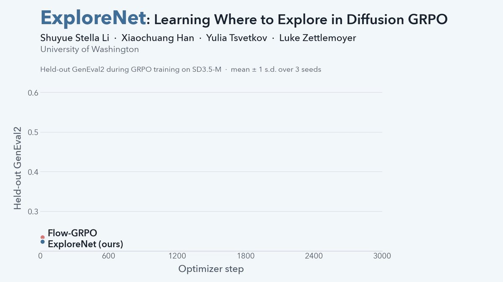

<div align="center">

# ExploreNet: Learning Where to Explore in Diffusion GRPO

**Shuyue Stella Li &nbsp;·&nbsp; Xiaochuang Han &nbsp;·&nbsp; Yulia Tsvetkov &nbsp;·&nbsp; Luke Zettlemoyer**

University of Washington

[](https://arxiv.org/abs/2609.38329)
[](LICENSE)
[](https://www.python.org/downloads/release/python-3100/)



</div>

## Overview

Group-relative RL methods such as Flow-GRPO post-train image generators by
exploring with isotropic Gaussian noise added at every denoising step. This noise
decides which rollouts the model learns from, yet it perturbs every channel and
spatial position of the latent equally. Latent elements differ in how much they
change the generated image, so exploration should adapt to these differences.

**ExploreNet** learns an adaptive exploration distribution. It is a policy that
predicts a noise scale for every latent element from the current latent, the
denoising step, and the prompt, before any reward is observed. It is trained on
the reward spread of each rollout group and discarded after training, so
inference is unchanged.

On Stable Diffusion 3.5 Medium, ExploreNet improves held-out GenEval2 by 14% over
Flow-GRPO, transfers to two independent compositional benchmarks and five
preference and image-quality models, and reaches a 67.2% human preference
win-rate.

## Results

Final checkpoint (update 3000), mean ± sample standard deviation over three
training seeds. ExploreNet is trained only on GenEval2.

| Metric | Flow-GRPO | ExploreNet |
|---|---:|---:|
| GenEval2 (held-out) | 0.4957 ± 0.0025 | **0.5661 ± 0.0318** |
| VLM Judge | 4.5083 ± 0.0946 | **4.7292 ± 0.0402** |
| GenEval | 0.6955 ± 0.0095 | **0.7350 ± 0.0096** |
| VVRBench-Fast | 0.7646 ± 0.0062 | **0.7902 ± 0.0188** |
| PickScore | 0.8448 ± 0.0019 | **0.8512 ± 0.0006** |
| HPSv2.1 | 0.2993 ± 0.0023 | **0.3056 ± 0.0040** |
| HPSv3 | 8.2112 ± 0.1784 | **8.8043 ± 0.1535** |
| Aesthetic | 5.4960 ± 0.0261 | **5.6638 ± 0.0596** |
| ImageReward | 1.1137 ± 0.0263 | **1.2774 ± 0.0154** |

## How it works

On top of [Flow-GRPO](https://github.com/yifan123/flow_grpo), a second SD3.5-M
transformer g_phi (with LoRA) predicts a score for every latent element at every
denoising step. The scores are standardized within each latent, clipped to
[-1, 1] as log-scales, and exponentiated into a scale map that multiplies
Flow-GRPO's per-step SDE noise coefficient. g_phi is trained with a clipped
PPO-style objective that rewards prompt groups whose rollouts spread out in
reward, plus a KL penalty toward N(0, I). The denoiser keeps Flow-GRPO's
objective, and g_phi is discarded at inference.

This repository contains the training code for the two configurations in the
paper (Flow-GRPO and ExploreNet on SD3.5-M with the GenEval2 reward) and the
GenEval2 prompt split they use.

## Repository structure

```
explorenet/
  noise_policy.py                 ExploreNet noise policy g_phi (SD3 transformer + LoRA)
  diffusers_patch/
    sd3_pipeline_with_logprob.py  SD3 sampling with per-step log-probs (+ learned noise)
    sd3_sde_with_logprob.py       Flow-GRPO SDE step and its Gaussian log-prob
    sd3_text_encoding.py          SD3 prompt encoding (CLIP-L, CLIP-G, T5)
  rewards.py                      GenEval2 Soft-TIFA reward client
  data.py                         GenEval2 prompt dataset and K-repeat prompt sampler
  stat_tracking.py                per-prompt GRPO advantages
  ema.py                          EMA of the denoiser LoRA
config/explorenet_sd35.py         the two paper configs
scripts/train.py                  training (Flow-GRPO, or ExploreNet when enabled)
scripts/geneval2_server.py        GenEval2 reward server (Qwen3-VL-2B-Instruct)
scripts/launch_with_geneval2.sh   start local reward servers, then run a command
scripts/prepare_geneval2_data.py  regenerate the train/test split
dataset/geneval2/                 GenEval2 prompts: 720 train, 80 test (CC BY-NC 4.0)
```

## Installation

Training uses Python 3.10 and the versions the paper runs used:

```bash
git clone https://github.com/stellalisy/ExploreNet.git
cd ExploreNet
python3.10 -m venv .venv && source .venv/bin/activate
pip install -r requirements.txt
pip install -e . --no-deps
```

The models are downloaded from the Hugging Face Hub on first use:
`stabilityai/stable-diffusion-3.5-medium` (gated; accept its license and run
`huggingface-cli login`) and `Qwen/Qwen3-VL-2B-Instruct` for the reward.

## The GenEval2 reward server

The training reward is GenEval2 Soft-TIFA (geometric mean): for each image, a
VQA model answers the GenEval2 questions of its prompt (the `vqa_list` field of
each row in `dataset/geneval2/*.jsonl`), the probability of the correct answer is
read from the first answer token, and the per-question probabilities are combined
by their geometric mean. The VQA model is **Qwen3-VL-2B-Instruct** in bf16.

Qwen3-VL needs `transformers>=4.57`, while SD3 training is pinned to
`transformers==4.45.2`, so the reward runs as a separate HTTP server process
(`scripts/geneval2_server.py`) in its own environment:

```bash
python3.10 -m venv .venv-reward && .venv-reward/bin/pip install -r requirements-reward.txt
CUDA_VISIBLE_DEVICES=0 .venv-reward/bin/python scripts/geneval2_server.py --port 18185 --device cuda
```

Each server holds one copy of Qwen3-VL-2B (about 5 GB of GPU memory). A `GET`
returns `ok` once the model is loaded. Training ranks reach the servers through:

| variable | meaning |
|---|---|
| `GENEVAL2_SERVER_URLS` | comma-separated URLs; rank `r` uses URL `r % len(URLS)` |
| `GENEVAL2_SERVER_URL` | a single URL (default `http://127.0.0.1:18185`) |
| `GENEVAL2_METHOD` | `soft_tifa_gm` (default, used in the paper) or `soft_tifa_am` |
| `GENEVAL2_REQUEST_TIMEOUT` | seconds per request (default 900) |

`scripts/launch_with_geneval2.sh` starts `GENEVAL2_NUM_SERVERS` servers on the
local GPUs, waits until all of them answer, sets `GENEVAL2_SERVER_URLS`, runs the
given command, and stops the servers afterwards. Set `GENEVAL2_PYTHON` to the
reward environment's python. In the paper runs, each of the 8 training nodes was
paired with a reward-only node running 8 servers (one per GPU). Running the
servers on the training GPUs also works when memory allows; we recommend
`REWARD_EXECUTOR_MAX_WORKERS=1` when many ranks share a server.

## Training

Configs are selected as `config/explorenet_sd35.py:<name>[,num_gpus=<N>]`:

- `flowgrpo_sd35_geneval2`: Flow-GRPO baseline.
- `explorenet_sd35_geneval2`: ExploreNet.

The two differ only in `sample.use_learned_noise_policy` and the
`noise_policy_*` keys. The default schedule is the paper's: 64 GPUs, per-GPU
microbatch 3, 8 sampling batches per iteration, 24 images per prompt (64 prompts
and 1,536 rollouts per iteration), gradient accumulation 4 (two optimizer updates
per iteration), 25 sampling steps, CFG 4.5, 512x512. With `num_gpus=N` (a multiple
of 8 that divides 512) the per-iteration batch and the two updates per iteration
are kept by scaling the number of sampling batches and the accumulation steps. The
paper used seeds 42, 123 and 456 (`--config.seed=...`) and reports the checkpoint
at update 3000 (`--config.max_global_step=3000`).

Logs go to W&B (project `$WANDB_PROJECT`, default `explorenet`; set
`WANDB_MODE=offline` to log locally) and to `<save_dir>/metrics.jsonl`. Checkpoints
are written to `<save_dir>/checkpoints/checkpoint-<update>/` every `save_freq`
iterations: `lora/` (EMA denoiser LoRA), optimizer and training state, and for
ExploreNet `noise_policy_module.pt` and `noise_optimizer.pt`. To resume, pass
`--config.train.lora_path=<save_dir>/checkpoints/checkpoint-<update>/lora` with the
same number of GPUs. Every `eval_freq` iterations the EMA denoiser is evaluated on
the 80 held-out GenEval2 prompts with deterministic (ODE) sampling; this is a
training monitor, not the paper's evaluation protocol.

**Single node (8 GPUs).** Reward servers on the same GPUs:

```bash
GENEVAL2_PYTHON=.venv-reward/bin/python GENEVAL2_NUM_SERVERS=8 REWARD_EXECUTOR_MAX_WORKERS=1 \
scripts/launch_with_geneval2.sh \
  accelerate launch --multi_gpu --num_processes 8 --mixed_precision fp16 scripts/train.py \
    --config=config/explorenet_sd35.py:explorenet_sd35_geneval2,num_gpus=8 \
    --config.seed=42 --config.save_dir=logs/explorenet_seed42
```

Replace `explorenet_sd35_geneval2` with `flowgrpo_sd35_geneval2` for the baseline.

**Multi-node (the paper setting, 8 nodes x 8 GPUs).** Start the reward servers
first (for example 8 per reward node), then run on every training node, with
`NODE_RANK` = 0..7 and `MAIN_ADDR` the address of node 0:

```bash
export GENEVAL2_SERVER_URLS=http://reward-node-0:18185,http://reward-node-0:18186,...  # 64 URLs, or fewer to share
export REWARD_EXECUTOR_MAX_WORKERS=1
accelerate launch --multi_gpu --num_machines 8 --num_processes 64 \
  --machine_rank $NODE_RANK --main_process_ip $MAIN_ADDR --main_process_port 29500 \
  --mixed_precision fp16 scripts/train.py \
  --config=config/explorenet_sd35.py:explorenet_sd35_geneval2 \
  --config.seed=42 --config.max_global_step=3000 --config.save_dir=logs/explorenet_seed42
```

## Compute

The paper runs used 64 H100 (80 GB) GPUs. Measured over updates 2160 to 2580,
Flow-GRPO takes about 152 s per optimizer update and ExploreNet about 189 s
(1.25x), i.e. about 162 and 202 GPU-hours per 60 updates respectively, including
periodic evaluation and checkpointing (training GPUs only; the reward servers ran
on separate nodes). A 3,000-update run is therefore roughly 8,100 GPU-hours for
Flow-GRPO and 10,100 GPU-hours for ExploreNet. ExploreNet keeps a second
2.5B-parameter SD3.5-M transformer (fp32) in memory; both methods fit the per-GPU
microbatch of 3 on 80 GB GPUs when the reward servers run elsewhere.

## Data and licenses

The code is released under the MIT License (see `LICENSE`), which keeps the
original Flow-GRPO copyright notice. The prompts in `dataset/geneval2/` come from
[GenEval 2](https://github.com/facebookresearch/GenEval2) (Kamath et al., 2025)
and are redistributed under their CC BY-NC 4.0 license, not under MIT; see
`dataset/geneval2/README.md`. SD3.5-M and Qwen3-VL-2B-Instruct are subject to
their own licenses.

## Acknowledgements

This code is built on [Flow-GRPO](https://github.com/yifan123/flow_grpo) (MIT
License). The SDE sampler with log-probabilities, the GRPO training loop,
per-prompt advantage tracking, and EMA come from Flow-GRPO.

## Citation

If you find this work useful, please cite:

```bibtex
@article{li2026explorenet,
  title   = {ExploreNet: Learning Where to Explore in Diffusion GRPO},
  author  = {Li, Shuyue Stella and Han, Xiaochuang and Tsvetkov, Yulia and Zettlemoyer, Luke},
  journal = {arXiv preprint arXiv:2609.38329},
  year    = {2026}
}
```
